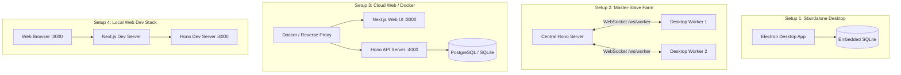

# 🚀 ApexLead — AI Lead Generation & Outreach Engine

**ApexLead** is an end-to-end lead discovery, enrichment, scoring, and cold email outreach platform. It automates finding business prospects via stealth web scraping, analyzes their websites and performance bottlenecks using AI, discovers verified contact info, and dispatches hyper-personalized outreach sequences.

---

## 🏛️ System Architecture & Monorepo Map

The repository is structured as a modular TypeScript monorepo with platform-agnostic core logic and interchangeable frontends and runtimes:

```
lead-gen-desk/
├── backend/               # 🧠 Core domain logic, DB entities, scraping engines & AI pipelines
├── electron/              # 🖥️ Native Desktop runtime, IPC handlers, stealth scraper & worker agent
├── frontend/              # 🎨 Shared React 19 UI (screens, state stores, visual canvas & adapters)
├── server/                # 🌐 Standalone Hono REST + WebSocket server (for web & cloud mode)
├── web/                   # 📱 Next.js 15 Web Edition frontend
├── plugins/               # 🔌 Extensible plugin engine (Discord, Slack, Webhook, HubSpot)
├── shared/                # 📦 Shared TypeScript models, contracts, and IPC enums
├── scripts/               # 🛠️ Database seeders and migration helpers
└── docker-compose.yml     # 🐳 Multi-container deployment for cloud/home server hosting
```

### Directory Breakdown
| Directory | Role & Description | Documentation |
| :--- | :--- | :--- |
| [`backend/`](./backend/README.md) | Shared business logic, TypeORM entities (SQLite/Postgres), graph execution engine, AI agents, SMTP/IMAP outreach. | [backend/README.md](./backend/README.md) |
| [`electron/`](./electron/README.md) | Desktop shell with direct OS access, Playwright stealth browser, embedded SQLite DB, and slave worker node. | [electron/README.md](./electron/README.md) |
| [`frontend/`](./frontend/README.md) | Modern React 19 UI with dual IPC/HTTP adapters, Zustand stores, and visual workflow builder. | [frontend/README.md](./frontend/README.md) |
| [`server/`](./server/README.md) | Hono REST API & WebSocket server with JWT auth, multi-tenancy, Swagger docs, and distributed worker coordinator. | [server/README.md](./server/README.md) |
| [`web/`](./web/README.md) | Standalone Next.js web application for browser access on local networks or the cloud. | [web/README.md](./web/README.md) |
| [`plugins/`](./plugins/README.md) | Extensible event hook system for external CRM synchronization and notification alerts. | [plugins/README.md](./plugins/README.md) |
| [`shared/`](./shared/README.md) | Cross-package TypeScript interfaces, schemas, and IPC channel definitions. | [shared/README.md](./shared/README.md) |
| [`scripts/`](./scripts/README.md) | CLI utilities for database initialization, seeding sample data, and testing. | [scripts/README.md](./scripts/README.md) |

---

## 🛠️ How Many Setups Can Be Done? (4 Deployment Modes)

ApexLead is designed to support **4 distinct deployment setups** depending on your workflow:



---

### Setup 1: Standalone Desktop App (All-in-One)
* **Best for:** Individual users on Windows, macOS, or Linux who want zero server setup.
* **Architecture:** Electron desktop app bundles the embedded SQLite database, Playwright scraping, and UI into a single self-contained application.
* **How to run:**
  ```bash
  npm install
  npm run dev
  ```
* **Build binary:** `npm run build:win`, `npm run build:mac`, or `npm run build:linux`.

---

### Setup 2: Distributed Master-Slave Farm (Central Hub + Desktop Workers)
* **Best for:** Scaling scrapers across multiple machines and residential IP addresses while keeping a single unified CRM database.
* **Architecture:** 
  1. A central API server (`server/`) is hosted on a cloud VPS or central machine.
  2. Multiple desktop instances run `electron/worker/worker-agent.ts` on local PCs, connecting via WebSocket (`/ws/worker`).
  3. The central server dispatches scraping tasks to the desktop workers, which execute them locally and stream the scraped leads back to the central database.
* **How to run:**
  1. Start Central Server: `cd server && bun run index.ts`
  2. In each Electron client, open **Settings → Workers** and enter the Central Server URL & token.

---

### Setup 3: Cloud / Home Server Web Edition (Docker Compose)
* **Best for:** Accessing ApexLead from any phone, tablet, or browser over your local network or VPS.
* **Architecture:** Runs the Next.js frontend (`:3000`) and the Hono API server (`:4000`) in Docker containers.
* **How to run:**
  ```bash
  docker-compose up -d --build
  ```
  Access at `http://localhost:3000` (or `http://<your-server-ip>:3000`).

---

### Setup 4: Local Web Development Stack
* **Best for:** Developers working on the web interface without running Electron.
* **How to run:**
  ```bash
  # Terminal 1: Backend API
  cd server && bun run index.ts

  # Terminal 2: Web Frontend
  cd web && npm run dev
  ```
  Access at `http://localhost:3000`.

---

## ⚡ External Services & API Configuration

All services can be configured in the **Settings** tab in the UI:

### 1. AI Engines (Scoring & Email Copywriting)
* **OpenRouter (Recommended):** Use Claude 3.5 Sonnet or GPT-4o cheaply via `openrouter.ai`.
* **OpenAI / Groq:** Standard API keys.
* **Local AI (Ollama / LM Studio):** Set base URL to `http://localhost:11434/v1` or `http://localhost:1234/v1`.

### 2. Website Speed Analysis
* **Google PageSpeed Insights API:** Enables automatic detection of slow prospect websites for personalized sales hooks.

### 3. Proxies (Recommended for High-Volume Scraping)
Configure HTTP / SOCKS5 proxies under **Settings → Network** (Webshare, IPRoyal, Proxy-Cheap) to prevent Google rate limits.

### 4. Email Accounts (Outreach & Warmup)
Add your SMTP and IMAP credentials under **Settings → Email Accounts** to enable automated email sending, jitter schedules, and reply sentiment triaging.
