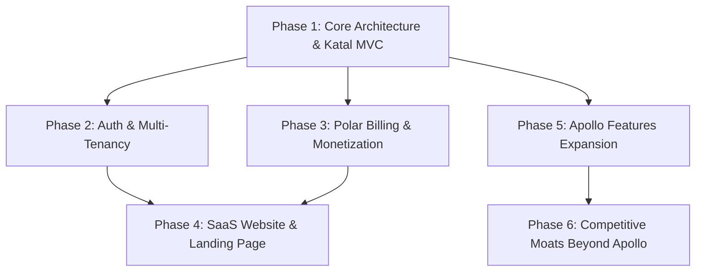

# ApexLead Next-Gen SaaS Architecture & Implementation Master Plan (v1)

> **Architectural Paradigm:** Clean MVC with Katal (`katal@3.0.0`), Polymorphic Dynamic JSON Schema, Polar.sh Monetization, Live Scraper Federation, and Apollo-Beating Sales Intelligence.

---

## 🎯 Executive Summary & Strategic Vision

ApexLead is transitioning from a desktop-first scraper into a **multi-tenant, enterprise-grade B2B Lead Generation & Sales Automation SaaS Platform**. 

While legacy platforms like **Apollo.io** and **ZoomInfo** rely on static databases where 40%+ of contact data is outdated within 6 months, ApexLead delivers a superior competitive moat:
1. **Live, On-Demand Data Scraping:** Real-time extraction across Google Maps, Clutch, G2, ThomasNet, YellowPages, Crunchbase, and contractor directories.
2. **Dynamic Polymorphic JSON Data Model:** Eliminates rigid, hardcoded lead schemas in favor of a flexible document/entity store with O(1) indexed identifier deduplication.
3. **Consolidated Katal MVC Architecture:** Merges fragmented `backend/` and `sdk/backend/` logic into a unified, high-performance `server/` powered by `katal@3.0.0` (IoC container, background queues, cron schedulers, standard schema validation).
4. **Developer-First Monetization via Polar.sh:** Automated merchant-of-record subscription billing, credit tier enforcement, and usage top-ups.
5. **Full Apollo-Parity & Beyond:** Multi-provider waterfall email enrichment, mobile direct dials, automated cold email sequences with reply triage, mailbox warmup, a LinkedIn Chrome extension, reverse-IP website visitor deanonymization, visual DAG pipeline automation, and conversational voice AI SDR callers.

---

## 🗺️ Master Phase & Implementation Roadmap

```
plans/v1/
├── README.md (This File)
│
├── phase-1-core-architecture-katal-mvc/
│   ├── 01-database-dynamic-json-schema.md
│   ├── 02-katal-mvc-scaffold-and-ioc.md
│   ├── 03-backend-merge-and-migration.md
│   └── 04-verification-and-backward-compat.md
│
├── phase-2-auth-and-multi-tenancy/
│   ├── 01-google-oauth-and-credentials-auth.md
│   ├── 02-tenant-isolation-and-org-management.md
│   └── 03-session-tokens-and-security.md
│
├── phase-3-polar-billing-and-monetization/
│   ├── 01-pricing-tiers-and-quota-limits.md
│   ├── 02-polar-sh-checkout-and-webhooks.md
│   └── 03-customer-portal-and-subscription-sync.md
│
├── phase-4-saas-website-and-landing-page/
│   ├── 01-high-converting-landing-page.md
│   ├── 02-pricing-page-and-calculator.md
│   ├── 03-apollo-comparison-and-seo-pages.md
│   └── 04-legal-onboarding-and-auth-pages.md
│
├── phase-5-apollo-features-and-expansion/
│   ├── 01-email-waterfall-and-direct-dials.md
│   ├── 02-multi-step-cadences-and-sequences.md
│   ├── 03-mailbox-rotation-and-warmup.md
│   ├── 04-chrome-extension-prospector.md
│   └── 05-visitor-deanonymization-tracker.md
│
└── phase-6-competitive-moats-beyond-apollo/
    ├── 01-live-realtime-scraper-federation.md
    ├── 02-visual-dag-pipeline-ecosystem.md
    ├── 03-autonomous-voice-sdr-caller.md
    └── 04-hybrid-edge-desktop-worker-network.md
```

---

## 🏛️ Key Architectural Decision Records (ADRs)

### ADR-001: Polymorphic Dynamic JSON Record Architecture
- **Problem:** Storing distinct entity types (Local Contractors, B2B SaaS Vendors, Industrial Manufacturers, Amazon Sellers, Corporate Executives) in a flat, hardcoded table (`LeadEntity`) resulted in schema rigidity, constant migrations, and nullable column bloat.
- **Decision:** Shift to a Polymorphic Document Entity model:
  - `records`: Stores `id`, `org_id`, `entity_type`, `title`, `status`, `source`, `enrichment_score`, and `data: jsonb` (PostgreSQL) or `data: text` (SQLite).
  - `record_identities`: Normalized table indexing deduplicators (`domain`, `email`, `phone`, `maps_place_id`, `linkedin_url`) with a unique constraint on `(org_id, identifier_type, identifier_value)`.
- **Benefit:** Instant O(1) deduplication across millions of rows without expensive full-JSON scans, supporting infinite custom vertical schemas.

### ADR-002: Consolidation of `backend/` into `server/` with `katal@3.0.0`
- **Problem:** Logic was fragmented across three directories: `backend/`, `sdk/backend/`, and `server/`. Route files in `server/` had 400+ lines mixing HTTP, SQL queries, and business logic.
- **Decision:** Consolidate everything into `server/` using Katal v3.0:
  - Real Inversion-of-Control (IoC) with constructor dependency injection.
  - True MVC: Models (TypeORM), Repositories (Tenant Scoped), Services (Domain Logic), Controllers (Katal HTTP handlers).
  - Built-in zero-dependency background queues for scrapers and webhooks.
  - Built-in cron schedulers for drip sequences and warmup monitoring.
- **Benefit:** Clean separation of concerns, 100% testable unit services, and single source of truth.

### ADR-003: Polar.sh as the Merchant of Record (MoR)
- **Problem:** Traditional Stripe integrations require handling global tax compliance (VAT, sales tax, nexus) and complex customer portal infrastructure.
- **Decision:** Use **Polar.sh** as the primary billing engine.
  - Polar handles developer subscriptions, automated tax calculation, global checkout, and customer management portals.
  - ApexLead syncs tier quotas (`free`, `starter`, `pro`, `agency`) through Polar Webhooks (`subscription.created`, `subscription.updated`, `subscription.canceled`, `order.created`).
- **Benefit:** Immediate legal readiness for global sales with zero tax liability and automatic tier enforcement.

### ADR-004: Dual Authentication Architecture
- **Problem:** B2B users demand frictionless Google Workspace OAuth, but developers and agencies require email/password and programmatic API keys.
- **Decision:** Implement a dual-auth system:
  - Google OAuth 2.0 (one-click signup/login).
  - Argon2id password hashing + email verification.
  - Unified JWT sessions with HTTP-only refresh tokens and tenant-scoped organization switching.
- **Benefit:** Maximizes conversion from Google Workspace users while serving privacy-focused self-hosters and agencies.

### ADR-005: The "Live Scraping + Edge Worker" Moat against Apollo
- **Problem:** Apollo has a large static database, but its data decays by ~30% annually, and running heavy browser scrapers in the cloud causes high RAM bills and proxy IP blocks.
- **Decision:** Implement a Hybrid Execution Model:
  - HTTP scrapers and enrichers run server-side at < 5 MB RAM per job.
  - Heavy Playwright scrapers run either via Cloud Browser Pool (for Pro/Agency tiers) or via the **Desktop Worker Farm** on the user's residential machine (for Free/Starter tiers).
- **Benefit:** Users get 100% fresh, real-time data with zero server OOM crashes and near-zero cloud infrastructure costs.

---

## 🚦 Execution Order & Phase Dependencies



---

## 📋 Definition of Done (DoD) per Phase

Each prompt file under every phase contains:
1. **Architectural Objective:** The precise problem solved and design rationale.
2. **Target File Modifications & New Files:** Explicit file paths across `server/`, `web/`, and `sdk/`.
3. **Database Schema & DDL:** Exact entity definitions and SQL migrations.
4. **Implementation Code Snippets:** Complete, production-grade TypeScript code blocks.
5. **Verification & Testing Protocol:** Specific `bun test` suites, curl commands, and typecheck passes.
6. **Execution Instructions:** Step-by-step commands for the agent or developer.
